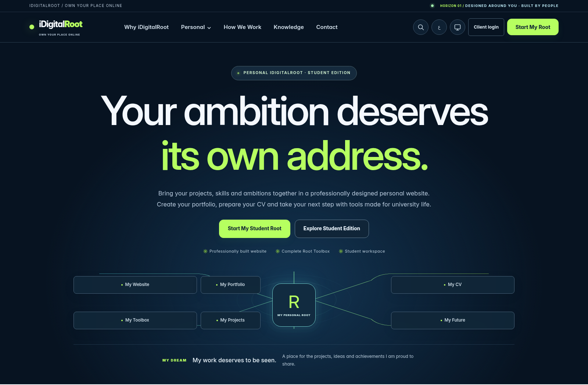
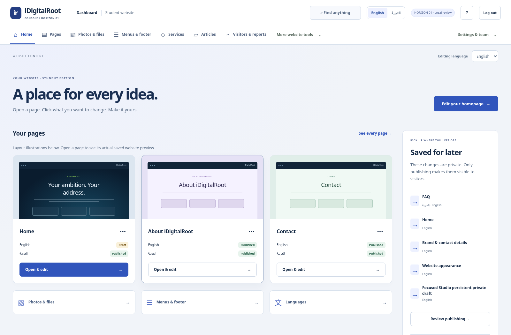
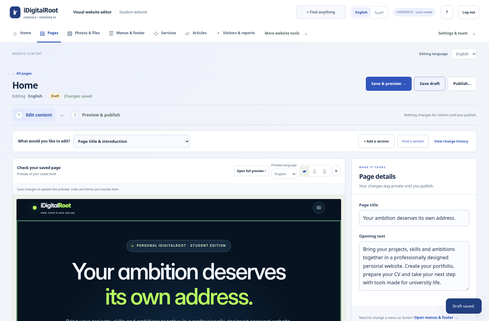

# iDigitalRoot / Horizon 01

**A new public website composition and a new Website Console.** This is the owner-requested replacement for the unaccepted Clarity presentation. Your content and section distribution are preserved.

[**Download Horizon 01 — 89 MB**](https://github.com/uyounmodel-cloud/idigitalroot/raw/refs/heads/main/downloads/IDIGITALROOT_HORIZON_REVIEW_2026-10-15_R1.zip) · [Simple installation guide](downloads/HORIZON_INSTALLATION_GUIDE.txt)

Close the older preview, extract this ZIP into a **new folder**, then double-click **OPEN_CONNECTED_PREVIEW.cmd**. Use your existing Windows + Ubuntu/WSL setup. Both applications and the launcher identify **HORIZON 01**. Compatible Clarity edits are copied into a separate local review; originals are retained. Verified Linux x64 dependencies are included.

## The public website

Central typography above a wide connected-system graphic replaces the former split opening. The dark navigation, supporting-page covers, cards and product sections share the new design. Every word, heading hierarchy, ordered destination and CMS section order is protected across all134 localized templates.

[Arabic desktop](docs/connected/screenshots/horizon-public-home-ar.png) · [Arabic phone](docs/connected/screenshots/horizon-public-phone-ar.png) · [Personal page](docs/connected/screenshots/horizon-public-personal.png)

## The Website Console

Pages come first. Open a page card, click a section in its **actual saved website preview**, and edit the filled-in content beside it. **Save draft → Save & preview → Publish…** retains explicit page/language confirmation. On phones the editing card appears above the canvas. Gallery covers are labelled layout illustrations; actual saved content appears after Open & edit.

[Full saved preview](docs/connected/screenshots/horizon-cms-preview.png) · [Arabic editor](docs/connected/screenshots/horizon-cms-section-ar.png) · [Phone editor](docs/connected/screenshots/horizon-cms-editor-phone-ar.png)

Photos/files, menus/footer, articles, services and visitor reports use horizontal navigation. More website tools, Settings & team and Find anything retain all27 CMS areas. Rich text, media approval, translation, schedules, history and permissions retain their existing contracts and external/manual gates. CMS language, content language and preview language remain independent.

## Verification and limits

[Exact-source verification report](docs/connected/VERIFICATION_REPORT.md) · [What changed](docs/connected/HORIZON_CHANGE_REPORT.md) · [Editing guide](docs/connected/HORIZON_OWNER_GUIDE.md) · [Security review](docs/connected/HORIZON_SECURITY_REVIEW.md) · [Checksums](downloads/SHA256SUMS.txt) · [Immutable source](downloads/IDIGITALROOT_HORIZON_SOURCE_2026-10-15_rc3.zip)

Fresh-extraction install/build, actual local Workers/D1/R2, inquiry/analytics/publishing, draft/privacy/CAS, EN/AR/RTL, responsive/keyboard/control and automated accessibility gates passed on the sealed source. The actual launcher passed cold/warm start/stop and copy-only data-continuity checks. These are local agent verification results, not owner or independent acceptance.

**Unaccepted local review candidate. Phase1 OPEN. Nothing deployed.** Owner Windows/manual/independent and legal/provider/security/QA/release gates remain open. Twelve Toolbox tools and sixteen Workspace positions remain presentation demos and mandatory commercial scope. Admin/Client dashboards and future multi-edition operations are not operational. No public signup added.

Original approvals and earlier immutable archives remain preserved. [Current metadata](downloads/CONNECTED_CURRENT.json) · [Authority register](docs/connected/AUTHORITY_REGISTER.md)
