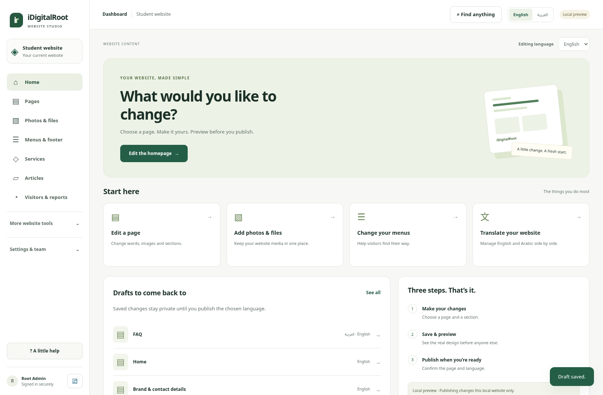
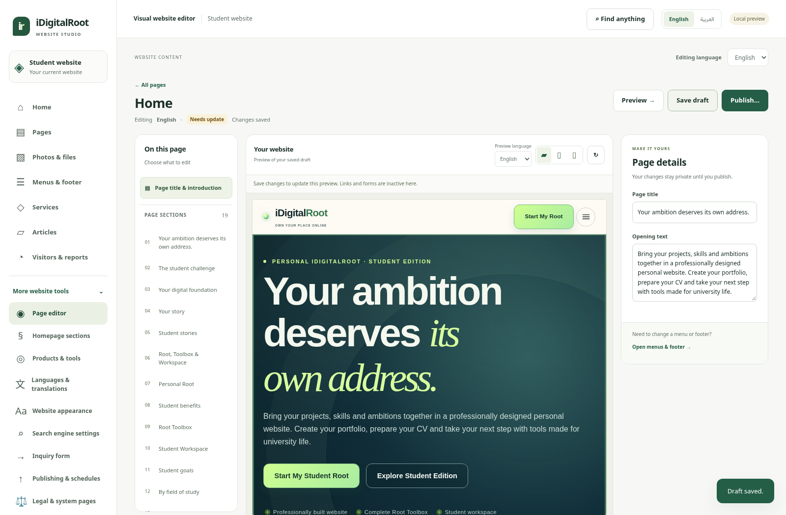

# iDigitalRoot — Website Studio review

The CMS has a new, simpler interface. The public website returns to the approved v4.3 visual baseline, with content, inquiry and analytics connections retained.

[**Download the connected Website Studio preview — about 87 MB**](https://github.com/uyounmodel-cloud/idigitalroot/raw/refs/heads/main/downloads/IDIGITALROOT_WEBSITE_STUDIO_REVIEW_2026-10-15_R1.zip) · [Installation guide](downloads/WEBSITE_STUDIO_INSTALLATION_GUIDE.txt)

Close your older preview, extract the new ZIP into a new folder, then double-click **OPEN_CONNECTED_PREVIEW.cmd**. Use your existing Windows + Ubuntu/WSL setup. Compatible older review edits are copied into a separate new review folder; the original stays available. Verified Linux x64 dependencies are included to avoid the previous npm registry timeout.

## A simpler way to edit

**Pages → Edit page → choose a section → Save draft → Preview → Publish…**

The real saved website appears inside the editor. Ordinary text is shown directly in filled-in fields; rich-content sections have formatting controls. The same screen handles saving, preview and explicit publication. English/Arabic and RTL are supported. Menus, media, services, articles, translations, analytics, publishing schedules and access controls remain available through simpler navigation.

[Arabic editor](docs/connected/screenshots/studio-editor-ar.png) · [Arabic section fields](docs/connected/screenshots/studio-section-ar.png) · [Phone view](docs/connected/screenshots/studio-home-phone-ar.png)

## Verification and status

[Verification report](docs/connected/VERIFICATION_REPORT.md) · [Editing guide](docs/connected/CMS_STUDIO_OWNER_GUIDE.md) · [Changes](docs/connected/CMS_STUDIO_CHANGE_REPORT.md) · [Security delta](docs/connected/CMS_STUDIO_SECURITY_REVIEW.md) · [Checksums](downloads/SHA256SUMS.txt) · [Immutable source ZIP](downloads/IDIGITALROOT_WEBSITE_STUDIO_SOURCE_2026-10-15_rc4.zip)

Local technical gates passed on the exact sealed source: clean pinned install, official Workers build, actual workerd/D1/R2, publication/inquiry/analytics flows,19 Studio checks, EN/AR, responsive and automated accessibility/route/control sweeps. Installer cold/warm startup and copy-only review-data continuity were checked. See the report for exact counts and limitations.

**This is a local review candidate. It is not owner-approved or deployed.** Phase1 remains open; provider/legal/independent security/manual QA/release gates and the new owner Windows run remain outstanding. All12 Toolbox tools and16 Workspace feature positions remain mandatory for the first commercial student release and are presentation demos here. Admin/Client dashboards and future multi-edition operations are not operational.

Original approved transfer files and previous download archives remain untouched. [Current artifact metadata](downloads/CONNECTED_CURRENT.json) · [Authority register](docs/connected/AUTHORITY_REGISTER.md) · [Previous connected review](docs/HISTORICAL_CONNECTED_RC9_README.md)
