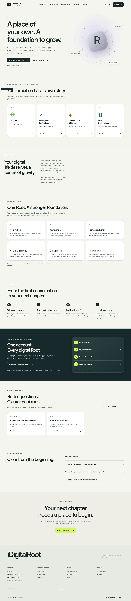
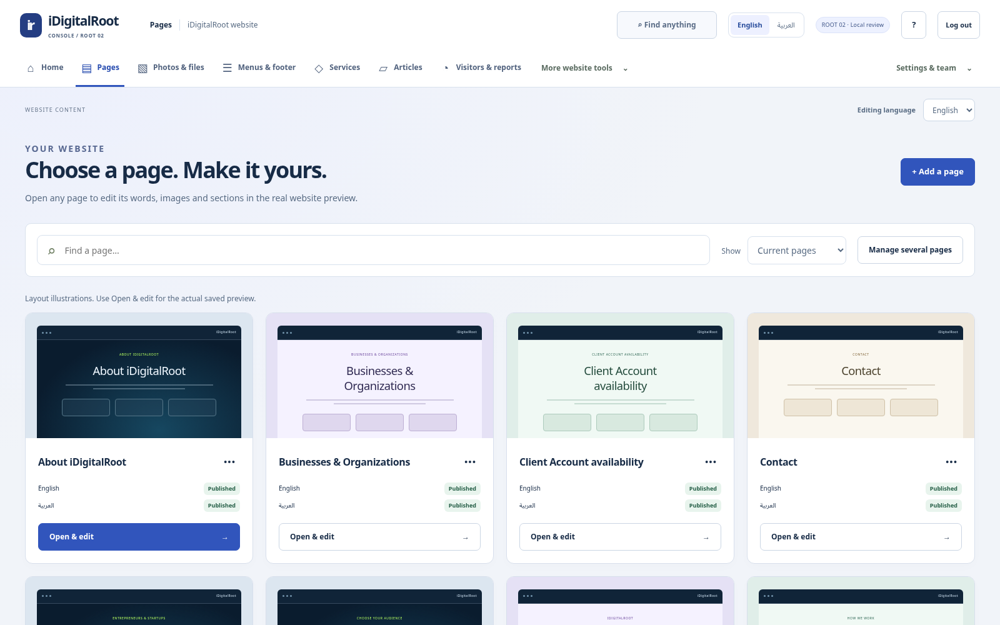

# iDigitalRoot / ROOT 02

**A new company website for everyone, with one complete story page for each audience.** The student-only public structure has been replaced. The CMS design you liked is retained.

[**Download ROOT 02 — 90 MB**](https://github.com/uyounmodel-cloud/idigitalroot/raw/refs/heads/main/downloads/IDIGITALROOT_ROOT02_REVIEW_2026-10-15_R2.zip) · [Installation guide](downloads/ROOT02_INSTALLATION_GUIDE.txt)

Close an older preview, extract this ZIP into a **new folder**, then double-click **OPEN_CONNECTED_PREVIEW.cmd**. Use your existing Windows + Ubuntu/WSL environment. Both applications identify **ROOT 02**. This starts separate review data; your older folders and drafts remain intact. Reopening this candidate keeps its own saved changes. Verified Linux x64 dependencies are included.

## Four audiences, one company

Students · Employees & Professionals · Entrepreneurs & Startups · Businesses & Organizations. Each gets its own complete story page, appropriate design and a quote wizard that starts with its audience already selected and editable. The team reviews needs and prepares the quote. No signup, automatic payment or instant price.

[Students](docs/connected/screenshots/root02-students.png) · [Professionals](docs/connected/screenshots/root02-professionals.png) · [Entrepreneurs](docs/connected/screenshots/root02-entrepreneurs.png) · [Businesses](docs/connected/screenshots/root02-businesses.png) · [Arabic desktop](docs/connected/screenshots/root02-public-home-ar.png) · [Arabic phone](docs/connected/screenshots/root02-business-ar-phone.png)

The shared company site explains website/domain/email/managed foundations, How We Work and the planned Client Account. A real published Knowledge library supports CMS-managed articles. The previous student subpages redirect to the single student story.

## The CMS you liked, connected locally

Choose a clearly named audience or shared page. Edit its words, photos, sections and main button in the saved-page canvas. Save & preview stays private. Publish names the exact page/language and requires explicit review. Articles, services, menus/footer, media, translations and analytics retain their dedicated workspaces.

[Actual audience editor](docs/connected/screenshots/root02-cms-audience-editor.png) · [Protected saved preview](docs/connected/screenshots/root02-cms-preview.png)

Menu drafts now immediately expose Preview and Publish controls. Private menu previews match system/light/dark appearance, and the narrow menu opens without scripts. Saving/cancelling review leaves public content untouched; publication changes only the reviewed entity and language. CMS UI language, editing language and preview language remain independent.

## Verification and release status

[Exact-source verification](docs/connected/VERIFICATION_REPORT.md) · [Architecture](docs/connected/UNIVERSAL_ARCHITECTURE.md) · [Editing guide](docs/connected/UNIVERSAL_OWNER_GUIDE.md) · [Threat model](docs/connected/UNIVERSAL_THREAT_MODEL.md) · [151-title security matrix](docs/connected/ROOT02_SECURITY_MATRIX.csv) · [345-requirement ASVS matrix](docs/connected/ROOT02_ASVS_5_0_0_MATRIX.csv) · [Checksums](downloads/SHA256SUMS.txt) · [Immutable source](downloads/IDIGITALROOT_ROOT02_SOURCE_2026-10-15_rc4.zip)

Clean fresh-extraction install/build, actual local Workers/D1/R2, four audience inquiries, real analytics/reporting, article publishing, CMS editing, menu/draft isolation, adversarial and automated accessibility checks passed on the exact sealed source. The actual operator passed cold/warm startup and edit persistence without altering earlier review data. These are local agent verification results, not owner or independent acceptance.

**Review candidate. Phase1 OPEN. Nothing deployed.** Owner Windows/manual/independent and legal/provider/integrated security/QA/release gates remain open. Client Account/Admin dashboards, full12 Toolbox tools and16 Workspace positions are still planned, not operational. All student tools remain mandatory commercial scope. This public rebuild does not claim the commercial platform is finished.

Historical approved authorities and earlier immutable archives remain preserved. [Current metadata](downloads/CONNECTED_CURRENT.json) · [Authority register](docs/connected/AUTHORITY_REGISTER.md)
