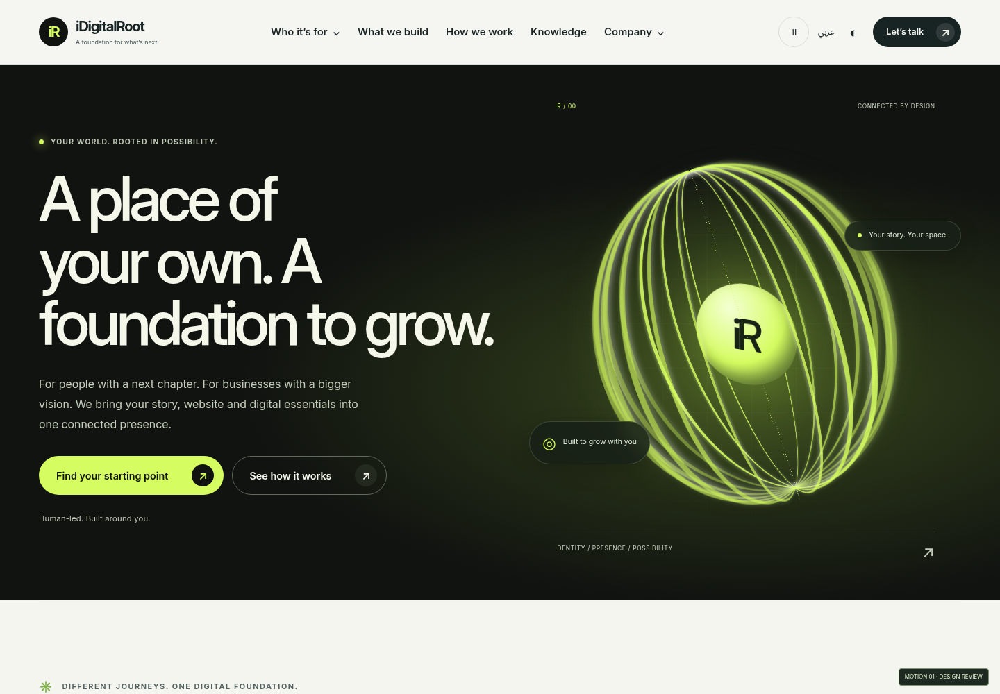
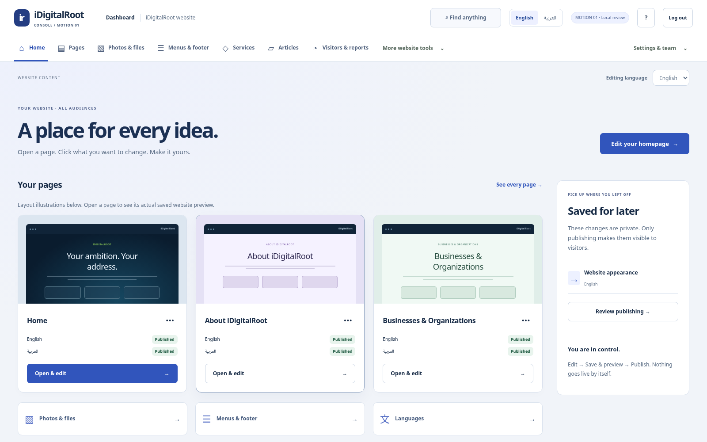

# iDigitalRoot / MOTION 01

## Client Account blueprint and AI handoff

[**Read the complete blueprint**](docs/client-panel/CLIENT_PANEL_BLUEPRINT.md) · [**Copy the question-first prompt**](docs/client-panel/START_NEW_CONVERSATION_PROMPT.txt) · [**Download the handoff ZIP — 2.3 MB**](https://github.com/uyounmodel-cloud/idigitalroot/raw/refs/heads/main/downloads/IDIGITALROOT_CLIENT_PANEL_BLUEPRINT_AND_AI_HANDOFF_2026-10-16_v1.1.zip)

Attach the small ZIP in a new conversation and paste its prompt. The AI must read the authority, ask unresolved questions in small rounds, and wait for explicit scope approval before creating the application. The package includes the complete Client blueprint, audience/feature/decision registers, original security authority and fresh151-risk/345-ASVS registers. **Planning proposal; Client/Admin/tools are not implemented or security-accepted.**

The [original master transfer](https://github.com/uyounmodel-cloud/idigitalroot/raw/refs/heads/main/downloads/IDIGITALROOT_CODEX_MASTER_HANDOFF_2026-10-14_v1.1.zip) is now preserved separately with its original hash for full pre-implementation reading. [Handoff guide and boundaries](docs/client-panel/README.md) · [Handoff integrity evidence](docs/client-panel/HANDOFF_VERIFICATION.json). Live databases/drafts/uploads and machine credentials still need separate private backups.

**The new motion-design review. Same company story, four audiences and connected CMS.**

[**Download MOTION01 — 94 MB**](https://github.com/uyounmodel-cloud/idigitalroot/raw/refs/heads/main/downloads/IDIGITALROOT_MOTION01_REVIEW_2026-10-16_R1.zip) · [Installation guide](downloads/MOTION01_INSTALLATION_GUIDE.txt) · [Watch the actual site move](docs/connected/screenshots/motion01-motion-preview.webm)

The public design now has a dimensional animated Root, larger audience portals, expressive typography, contrasting editorial sections, pointer response and scroll reveals. The pause control remembers your preference; your device's Reduce Motion setting takes priority. Content and navigation work without JavaScript. No stock video, external font/CDN or animation library is needed.

## Open this version

Close the older preview, extract this ZIP into a **new folder**, then double-click **OPEN_CONNECTED_PREVIEW.cmd** with your existing Windows+Ubuntu/WSL setup. Confirm **MOTION01** on the website and CMS. An old shortcut still opens the old design. Keep the launcher open while browsing.

Compatible ROOT02 review content is copied into a separate candidate folder; originals remain unchanged. MOTION01 keeps its own subsequent edits. Nothing is reset or automatically published. Older incompatible review datasets remain separate. [Editing and data-preservation guide](docs/connected/MOTION_OWNER_GUIDE.md)

## Explore the design

[Full homepage](docs/connected/screenshots/motion01-public-home.png) · [Students](docs/connected/screenshots/motion01-students.png) · [Professionals](docs/connected/screenshots/motion01-professionals.png) · [Entrepreneurs](docs/connected/screenshots/motion01-entrepreneurs.png) · [Businesses](docs/connected/screenshots/motion01-businesses.png) · [Arabic desktop](docs/connected/screenshots/motion01-public-home-ar.png) · [Arabic phone](docs/connected/screenshots/motion01-business-ar-phone.png) · [Knowledge](docs/connected/screenshots/motion01-knowledge.png)

The four audience stories, shared services, How We Work, Knowledge and team-reviewed quote remain connected. All30 localized page definitions retain the exact editable headings/paragraphs/field positions/CTA contracts from ROOT02. No signup, charge, instant quote or fake working account is added.

## Your connected CMS stays familiar

The Horizon console layout is retained. Edit a named page, Save & preview privately, then explicitly review and publish the named entity/language. Protected preview uses the new visual design with static decoration. Menus/footer/articles/services/media/translations/analytics retain their own workspaces and publication scopes.

[Audience editor](docs/connected/screenshots/motion01-cms-audience-editor.png) · [Protected saved preview](docs/connected/screenshots/motion01-cms-preview.png)

## Evidence and limits

[Exact-source verification](docs/connected/VERIFICATION_REPORT.md) · [Test matrix](docs/connected/TEST_MATRIX.csv) · [Motion threat model](docs/connected/MOTION_THREAT_MODEL.md) · [151-title security matrix](docs/connected/MOTION01_SECURITY_MATRIX.csv) · [345-requirement ASVS matrix](docs/connected/MOTION01_ASVS_5_0_0_MATRIX.csv) · [Immutable source](downloads/IDIGITALROOT_MOTION01_SOURCE_2026-10-16_rc2.zip) · [Checksums](downloads/SHA256SUMS.txt)

Fresh pinned install, official Cloudflare build/actual local Workers/D1/R2, real inquiries/analytics, CMS editing/publication/draft isolation, motion/reduced-motion/no-JS, EN/AR responsive and automated accessibility checks passed on the exact sealed source. Exact operator cold/warm startup, copied ROOT02 preservation and private-draft persistence were verified. The short recording is actual browser output. Performance diagnostics are local observations, not a production benchmark.

**Candidate awaiting owner review. Phase1 OPEN. Nothing deployed.** Windows/manual/native Arabic/independent security/QA/legal/provider/release gates remain open. Client/Admin dashboards and all12 Toolbox/16 Workspace positions are still planned, not operational. No commercial-platform completion or zero-vulnerability claim.

[Current metadata](downloads/CONNECTED_CURRENT.json) · [Authority register](docs/connected/AUTHORITY_REGISTER.md). GitHub preserves the delivered source/packages/docs/setup; original master transfer, live review databases, credentials and all machine state are not automatically backed up here.