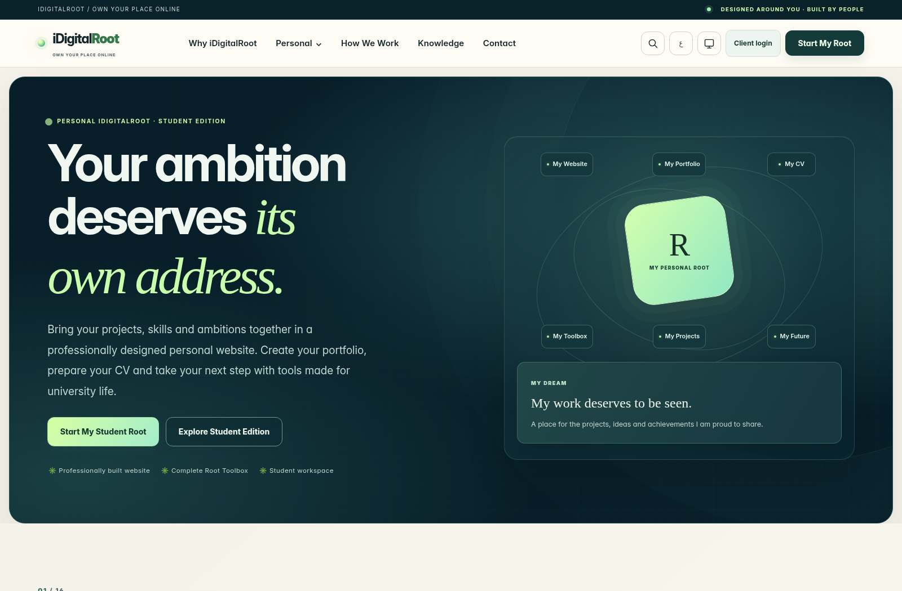
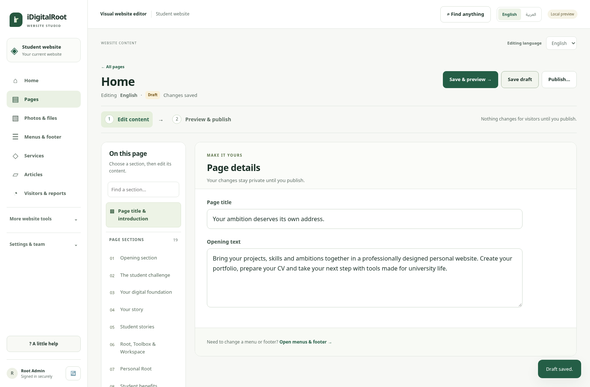

# iDigitalRoot — enterprise website and simpler CMS

The public website has a new enterprise futuristic visual direction, with its content and chapter order preserved. The CMS separates everyday editing from previewing so its controls have room to breathe.

[**Download the connected review — 90 MB**](https://github.com/uyounmodel-cloud/idigitalroot/raw/refs/heads/main/downloads/IDIGITALROOT_CLARITY_REVIEW_2026-10-15_R1.zip) · [Installation guide](downloads/CLARITY_INSTALLATION_GUIDE.txt)

Close the older preview, extract the new ZIP into a **new folder**, then double-click **OPEN_CONNECTED_PREVIEW.cmd**. Use the existing Windows + Ubuntu/WSL setup. Compatible earlier edits are copied into a separate review; originals are kept. Verified Linux x64 dependencies are included.

[Arabic phone design](docs/connected/screenshots/clarity-public-phone-ar.png) · [Personal page](docs/connected/screenshots/clarity-public-personal.png)

## A clearer editing flow

**Choose page and section → Edit content → Save & preview → Publish…**

Edit in large filled-in fields, then inspect the real saved design in a separate preview. Search sections/page text; phones use a simple section picker. Advanced options stay available under More section options. The media library has protected approved-photo thumbnails. Photos stay in their selected sections. English/Arabic content, CMS language and preview language are independent.

[Saved preview screen](docs/connected/screenshots/clarity-preview-en.png) · [Arabic section editing](docs/connected/screenshots/clarity-section-ar.png) · [Phone editor](docs/connected/screenshots/clarity-editor-phone-ar.png)

Menus/footer, media, services, articles, translations, analytics, scheduling, history and team controls remain available. Existing external/manual gates still apply to advanced features.

## Evidence and status

[Verification report](docs/connected/VERIFICATION_REPORT.md) · [Editing guide](docs/connected/CLARITY_OWNER_GUIDE.md) · [Changes](docs/connected/CLARITY_CHANGE_REPORT.md) · [Security delta](docs/connected/CLARITY_SECURITY_REVIEW.md) · [Checksums](downloads/SHA256SUMS.txt) · [Immutable source ZIP](downloads/IDIGITALROOT_CLARITY_SOURCE_2026-10-15_rc3.zip)

The exact sealed source passed fresh-extraction install/build, actual local Workers/D1/R2, connected publishing/inquiry/analytics, EN/AR/RTL, responsive, keyboard, route/control and automated accessibility checks. All134 localized static route templates match the previous content/distribution exactly. The launcher passed cold/warm startup and copy-only data-continuity checks. See the report for counts and limitations.

**Local review candidate; not owner-approved or deployed.** Phase1 remains OPEN. Owner Windows acceptance and legal/provider/independent security/manual QA/release gates remain outstanding. All12 Toolbox tools and16 Workspace positions remain required commercial scope and presentation demos here. Admin/Client dashboards and future multi-edition operations are not operational.

Original transfer approvals and previous archives remain untouched. [Current metadata](downloads/CONNECTED_CURRENT.json) · [Authority register](docs/connected/AUTHORITY_REGISTER.md)
