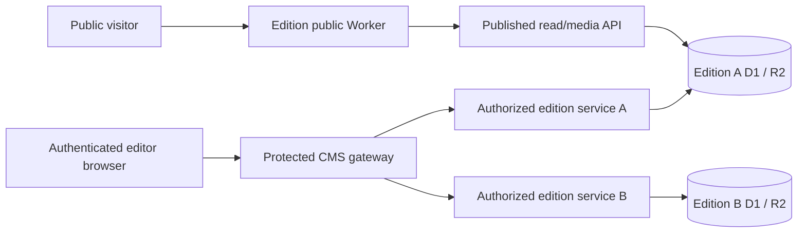
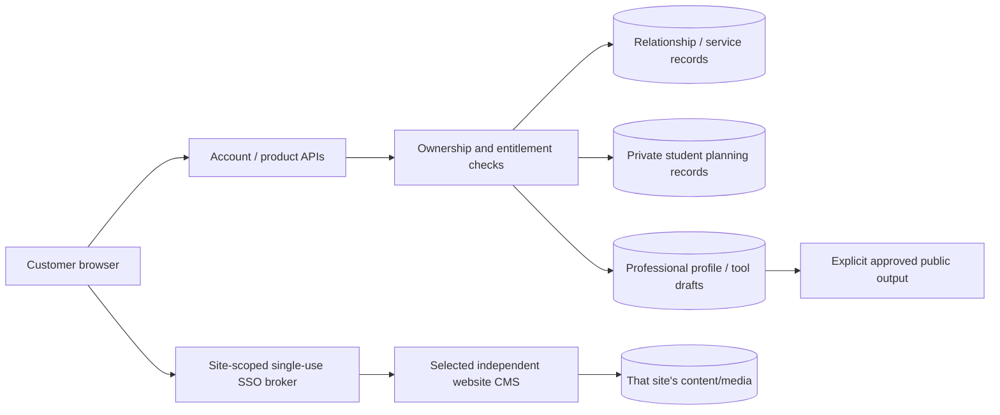

# Threat model addition: edition management and mandatory student modules

Status: design/threat review, not security acceptance. ASVS v5.0.0 strong L2 and applicable privileged L3 controls, OWASP Top 10:2025/API Top 10:2023 and SSDF final v1.1 remain the authorities. The existing 160-title security baseline remains open pending integrated verification; these risks are additions, not replacements.

## Proposed data flows and trust boundaries

These are logical boundaries; no new production services, databases or storage have been provisioned. Website content, platform relationship data and private student planning are separate authorities. The gateway cannot rely on browser-selected IDs as permission evidence.

## Assets, actors and entry points

Assets: published/draft content, legal approvals, media rights, revision history, previews, staff sessions and scopes, audit evidence, analytics/export records, customer accounts/entitlements, professional profiles/CVs, academic plans, private reflections, application histories, contact details, budgets, shared outputs and backups.

Actors: anonymous visitor, authenticated customer owning one/many sites, authorized editor, editor denied another edition, privileged staff/root owner, suspended/former user, compromised browser/integration and malicious external recipient.

Entry points: edition selection, content/media/translation/publishing APIs, schedules, preview and SSO endpoints, search, analytics ingestion/query/export, tool CRUD/export/share, import/upload/reference URLs, notifications, account/audience changes, backups and privileged configuration.

## Risks and required controls/evidence

| Abuse/failure | Required control | Negative verification |
|---|---|---|
| Wrong-edition publish/read/export/cache | Code-owned registry, server edition authorization and object/function/property scope; partition caches/pointers/storage | Forge edition/header/object IDs; replay A preview in B; concurrent tabs and delayed responses |
| Cross-account private data access | Ownership/entitlement checks on every record, export and shared object | BOLA/IDOR, guessed IDs, bulk/export/secondary endpoint bypass |
| Persona change grants access or deletes history | Audience recommendations separated from durable entitlement/service contracts | Student -> employee -> business changes preserve data and purchased access; tampered profile cannot unlock functions |
| Private planner/journal/budget becomes public | Private defaults, separate data domain and explicit sharing boundary | Export/share default-deny, mixed record selection, revoked/expired access |
| CV/portfolio/reference/render injection | Typed bounded input, contextual encoding, server sanitization and safe code-owned renderers | Stored/reflected/template/command/SQL injection payloads; unsafe URLs and malformed exports |
| Research URL fetching or unsafe media intake | No arbitrary URL fetch by default; registered SSRF-safe fetch contract when justified; validation/quarantine and object isolation | Private IP, redirects, rebinding, oversized files, MIME/polyglot/path traversal, unsafe inline serving |
| Stale draft/save or approval overwrite | Immutable revisions, server concurrency guard, exact-version preview and approved transitions | Stale versions, simultaneous edits, race/partial failure, retries/idempotency |
| Session/SSO/ticket confused deputy | Secure session lifecycle, CSRF/origin verification; signed short-lived single-use audience/site/user-bound tickets | Fixation, logout/expiry, replay, tampering, wrong user/site/issuer, simultaneous ticket consumption |
| Abuse and resource exhaustion | Payload/rate/usage bounds, least-privilege bindings and bounded jobs/exports | Oversized inputs, timer/job races, bulk storms, export amplification and failure-open paths |
| False healthy/empty metrics after outage | Explicit unavailable/stale status; never report failure as zero or healthy | Analytics/storage/provider failure while retaining truthful UI state |
| Secret/PII exposure | Restricted logs/diagnostics, export authorization, redaction and secret lifecycle | Browser bundle/storage, screenshots, request/log captures, error paths and stale download links |
| Upgrade/migration corrupts existing tenants | Versioned contracts/profile/module registry, compatible rollout, restore-tested backups | Old profile compatibility, per-edition rollout, migration/replay/rollback and restoration |

These controls must be traced to applicable baseline/ASVS requirements at implementation time. No title is marked N/A without architecture-specific rationale. Provider behavior, adversarial gates, backups/restores and independent acceptance cannot be inferred from local fixture tests.
