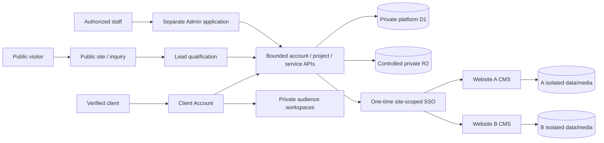

# iDigitalRoot Client Account — complete product and technical blueprint

Version 1.2 · 16 October 2026 · **DISCOVERY PROPOSAL, NOT AN APPROVED IMPLEMENTATION SCOPE**

## 1. Purpose, authority and current state

Build the customer operating center for the relationship with iDigitalRoot: account/profile/security, independent Digital Roots, website projects, approvals, services, renewals, support and audience-appropriate private tools. One person can evolve from student to professional/founder while preserving their identity, history and purchased entitlements.

The complete original Client Account v1.0 DOCX and Admin blueprint remain foundational authorities. The owner's later full Student Toolbox/Workspace requirement explicitly extends the earlier relationship-only account model. The last conversation proposes a seven-area navigation and additional professional/startup/business workspaces; those new recommendations are **not owner-approved merely because they are written here**. FEATURE_INVENTORY and DISCOVERY_QUESTIONS identify authority/status.

The current public site is one company website with four complete audience pages, not four deployed tenant editions. MOTION01 replaces ROOT02 visually and retains its content/contracts. Its local32-step evidence does not prove production closure, actual deployment or a Client/Admin implementation. Phase1 security/QA/legal/provider/release gates remain OPEN. The original order is Public/CMS -> Admin -> Client -> reusable client CMS -> factory. The owner now wants Client Panel planning next; ask explicitly how implementation should handle original phase order and staff-side prerequisites before reordering implementation. Planning does not close earlier release gates.

## 2. Product family and data ownership

| System | Owns | Must remain separate from |
|---|---|---|
| Public website and dedicated CMS | Corporate marketing, four audience stories, Knowledge, public navigation/content | Internal staff operations and private customer tools |
| Public backend/lead boundary | Anonymous inquiry and lead qualification handoff | Automatic creation of an activated customer account |
| Admin & Operations | Staff identities/permissions, clients/projects, service/plan/quote/billing/support operations, configuration and audit | Client UI and unrestricted access to every website's content database |
| Client Account | Customer relationship/profile, owned-root metadata, project interaction, entitlements, requests, private workspaces | General website builder, hosting control panel or duplicated CMS |
| Each client website CMS | Its own website content/media/users and detailed site analytics | Other client sites and the central account's private workspace data |
| Reusable site CMS/factory | Controlled isolated site profiles/templates and supported capabilities | Arbitrary executable customer content or unconstrained production code generation |

Shared platform services can be authoritative for both staff and client operations through different authorized API surfaces; do not duplicate quotes/projects/entitlements into conflicting databases. Per-client website data remains independently isolated. Logical application boundaries do not automatically require one physical database per frontend; the approved storage/security plan must justify physical boundaries.

## 3. Personas and non-authorizing audience profiles

Initial audience labels: Students; Employees & Professionals; Entrepreneurs & Startups; Businesses & Organizations. Public quote wizard also supports Not sure. Audience is a recommendation/context property, never a security role or entitlement. Do not infer access from a theme, URL, query string, profession or client-controlled profile field.

Keep separate concepts: authenticated user; commercial ClientAccount; membership/role if approved; client profile; individual Website/DigitalRoot and website profile; purchased plan/subscription/entitlements; audience presentation preference. One client may own multiple independent Roots. Whether a person may belong to several accounts, business team seats, delegated approvers/billing contacts and ownership transfers are first-release discovery decisions. The original blueprint places enterprise multi-user accounts in future scope; do not silently include them in v1.

A change from Student to Professional should preserve work/history and show the new relevant recommendations. It must not silently cancel services, delete academic data, start charges or grant business permissions. Retention and access after an entitlement change require explicit policy.

## 4. Navigation and experience

Proposed main navigation: **Home; My Digital Roots; My Workspace; Services; Billing & Renewals; Support; My Account.** Notifications use a bell and inbox. Website-specific project/domain/email/service/history screens live within the selected Root; global Services can aggregate the account. This simplifies the original broader IA without removing capabilities. Labels/navigation need owner discovery approval.

Home answers: What needs attention? What do I own? What is being built? What renews? What changed? Show one priority Hero, Needs Your Attention, Root cards, next renewals, open requests and recent activity. Priority order: security/critical -> required approval/missing information -> renewal/payment -> project update -> relevant service -> general campaign. Operational warnings and promotions are visibly different; promotions never cover required work. Do not invent completion percentages or live status.

Root cards adapt to lifecycle. Onboarding: Continue setup. Building: View project / Review version. Live: Visit website / Open Website Admin / Details. Renewal risk: clear affected service/date/action. Avoid advanced filters for a one-site client; provide useful filters/pagination for many sites.

The panel is a calm working product. Carry the public brand quality without imposing continuous decorative motion on forms, invoices, approvals or study tools. Responsive phone/tablet/desktop, semantic keyboard UI, meaningful empty/loading/error states and reduced motion are required. Arabic is native RTL from the first layout; date/time/currency and translations are real, not a mirrored English screenshot. Interface language, account preference and website content language are independent.

## 5. Customer activation, profile and security

Recommended starting journey: inquiry -> authorized staff qualification -> versioned quote -> explicit acceptance -> invitation -> verified activation -> secure login. Final activation policy and whether tools-only customers exist are unresolved. No anonymous public signup is authorized by the existing public contract. Lead/contact identity is not an activated client identity. Staff cannot provision customer passwords for reuse or put credentials into invitation URLs.

Select the authentication approach after discovery: Workers-compatible secure sessions, password/passkey strategy, recovery, MFA capability and production verification/delivery arrangements. Evaluate existing suitable components before inventing authentication. Use short-lived single-use invitation/verification/recovery capabilities; secure HttpOnly/Secure/appropriate SameSite cookies; session rotation/idle+absolute expiry/revocation; CSRF/origin checks; uniform enumeration-resistant errors and layered abuse limits. Privileged staff MFA is mandatory. Client MFA must be supported from the production architecture; mandatory conditions are a risk/policy decision. Sensitive changes require recent re-authentication/verification.

Client profile includes account/contact name, verified contact email, phone/country, preferred language, communication preferences and billing identity where applicable. It is not the public website biography. Security includes active sessions/devices, logout/revoke, authentication-method management, notifications and account-recovery controls. Never ask the owner for raw production secrets in chat.

## 6. Multi-Root lifecycle and onboarding

Root lifecycle: request draft -> submitted -> under review -> accepted/quoted -> onboarding/discovery -> information ready -> architecture/design/development -> QA -> client approval -> launch ready -> live -> maintenance/renewal -> suspended/expired/archived when applicable. Client-facing stages stay simple; staff can have deeper authorized stages. The state machine, transitions, actor permissions, required evidence and cancellation/reopening rules must be explicit.

New Website is an explicit action, independent of account activation. Use one versioned blueprint/questionnaire engine with typed field groups, conditional rules, required/optional flags, help text, ordering and validators. Admin configures supported schemas; no arbitrary JavaScript/formula execution. Capture website type/goals, existing brand/logo, private intake, desired domain, languages, design/palette preferences, safe reference URLs, functions, email and additional service requests. Intake functions outside a plan become reviewed scope, not automatically purchased capabilities.

Autosave actual drafts, show last saved state, resume across sessions, validate server-side and use version/concurrency control across tabs. Bind a submitted project to the exact questionnaire/blueprint version; later template edits must not reinterpret historical answers. Submission is idempotent and does not purchase/register/deploy anything. Draft abandonment, retention, duplicate submission and account closure require policy.

## 7. Projects, previews, approvals and launch

Each project has current stage, next milestone, responsibilities, client actions, important dates, private communication, releases/previews, versions and approval units. Staff-only notes never enter client responses/exports. Previews are authenticated, site/account-bound, limited lifetime, no-store/noindex and revocable as appropriate. An embedded iframe needs an explicit safe origin and capability design; never bypass browser/CSP protections for convenience.

Approval records bind user/account/site/project/stage + immutable artifact/version/hash + decision/comments/time. Approved history is not editable; supersede with a new version. Test stale tabs, version replacement after review, simultaneous approval/change requests, replay and cancelled authorization. An approval means approval of that exact artifact, not permission for unrelated scope or deployment.

Launch checklist can include approved design/content, domain/email readiness, QA/security/legal state and explicit final authorization. Staff performs deployment only under separate release authority. Project -> Live transformation preserves history. Do not show a working CMS action until the correct isolated CMS is actually available/authorized. The reusable client CMS is a later product; a broker contract/test consumer is not proof that client CMSs have been deployed.

## 8. Domains, email, services and Root Health

Domains: associated Root, external/managed state, ownership/responsibility, status, renewal date/amount and safe support/transfer assistance. No ordinary raw DNS/registrar secrets. Registration/transfer/renewal actions require provider-specific authority and commercial consent; provider authentication alone is insufficient.

Email: domain-associated mailbox metadata, status, setup instructions, vetted webmail link, supported reset path, request extra mailbox/support. No reusable credentials displayed or sent through account browser storage. Never pretend to provision a mailbox when only a local fixture exists. Providers, mailbox/storage limits and costs remain undecided.

Service classes retain Included / Free Integration / Paid Add-on / Custom Service / Future. A catalogue record states capability, availability, eligibility, scope, dependencies, costs/limits, supported locales and owner. Plan/price/terms versions are immutable for accepted contracts. New feature implementation remains a code release, not Admin creating arbitrary functionality.

Root Health is a truthful managed-service summary: availability, domain/renewal, email, certificate and backup state only when actually measured/operated. Show evidence source, last verified time and Unknown/Unavailable/Stale states. A missing/failing integration cannot become Healthy. Detailed website analytics stay in the site CMS. Social profiles are validated manual links; no paid/social analytics API, scraping or AI dependency in v1.

## 9. Service focus by audience

| Audience | Recommended service focus; all exact inclusions/costs require accepted contract |
|---|---|
| Students | Personal website, education/projects/portfolio, domain/email where purchased, professional identity, full Toolbox/Student Workspace |
| Professionals | Expertise/experience website, achievements/case studies, professional contact identity, portfolio and career development |
| Entrepreneurs | Founder/company/launch presence, product/service presentation, inquiry capture, brand preparation and launch planning |
| Businesses | Corporate/service/case-study/location/multilingual websites, domain/email operations and defined ongoing care |

Booking/ecommerce/memberships/large integrations remain scoped service requests until designed, costed, permissioned and accepted. No invented prices, free domain/email guarantees, rankings, employment outcomes or unlimited resource promises.

## 10. Private tools and audience workspaces

All tools use the authenticated account/site/owner scope appropriate to their data. Feature visibility is convenience; entitlement, object and action checks happen server-side. Use durable storage for meaningful work, explicit save/autosave, version handling, quotas, export, retention and truthful error/recovery. No arbitrary persistent vault or executable content. Public outputs require a deliberate share/export/publish action and a narrow approved CMS handoff; no general central-to-site content synchronization.

### 10.1 Required Student Toolbox — all 12

| Tool | Minimum useful output / acceptance |
|---|---|
| CV Studio | Structured CV, real preview and agreed export; drafts/private contact information protected |
| Portfolio Builder | Curated projects/descriptions/media with explicit public selection and CMS ownership preserved |
| Digital Card | Editable professional card, safe destination and privacy-aware share |
| QR Studio | Actual scannable approved-destination QR, agreed export and mobile scan test |
| Link Hub | Validated links, order/visibility and explicit safe sharing |
| Achievement Kit | Credentials/awards/experience with private/public choice; no fabricated verification |
| Career Kit | Assemble selected CV/projects/contact material for an opportunity; same engine from both menus |
| Email Signature | Safe usable signature, agreed copy/export and real mail-client compatibility |
| Project Share | Selected project output with explicit audience/access/expiry/revocation policy |
| Personal Brand Kit | Biography/photo/brand assets with safe intake and controlled outputs |
| Contact Card | Genuine contact-file output and supported-client import test |
| Root Export | Defined user-owned data export with scope/format/privacy/import limits stated |

### 10.2 Required Student Workspace — all 16 positions

University life: My Semester; Study Planner; Exam Countdown; Project Desk; Study Timer; Goals.
Career/future: Application Tracker; **Career Kit (same Toolbox capability)**; Cover Letter Guide; Skills Passport; Career Roadmap.
Personal growth: Learning Log; Experience Journal; Research Shelf; Campus Calendar; Student Budget.

That is28 menu positions and27 distinct capabilities across Toolbox+Workspace. All majors get the complete approved student scope; a major changes recommendations, not tool access. My Semester stores courses/dates; Study Planner tasks/sessions; countdowns are timezone-aware; timer handles background/reload/clock changes by agreed policy; applications/skills/learning/reflections are private and never silently public; Research Shelf stores safe references without arbitrary server URL fetching; Calendar has no assumed external sync; Budget has correct currency/period totals and no banking/accounting integration. Minimum per-feature tests are in FEATURE_INVENTORY.

### 10.3 Professional Workspace — proposed, not approved

Recommend reuse of CV/portfolio/achievements/Career Kit, Application Tracker, Cover Letter Guide, Skills Passport, Career Roadmap, Goals, Learning Log and relevant professional evidence. This is a focused presentation/entitlement profile over reviewed capabilities, not a second conflicting career database. Confirm the actual first-release profile and labels during discovery. Do not silently make student academic records visible to professional/business collaborators.

### 10.4 Entrepreneur Workspace — proposed additions

Venture Profile & Brand Brief; Offer Planner; Pitch One-Pager; Launch Planner/checklist/milestones. Reuse relevant Portfolio/Brand/Digital Card/QR/links/signature/Project Share/contact/export capabilities. These are bounded private planning/output tools, not a new full CRM, accounting suite, automated business advisor or production website generator. Agree exact fields, formats, persistence/sharing, limits and service handoff before creation.

### 10.5 Business Workspace — proposed additions/profile

Account-level multi-Root overview/approvals/renewals reuse core screens. Proposed additions are a Digital Asset Register (authorized references/metadata, never a credential vault) and Marketing/Content Request Briefs (structured service requests, not website CMS replacement). Company Brand Kit and campaign QR/link materials reuse supported toolbox capabilities. Business team seats/delegation remain separately scoped, with no shared login.

### 10.6 Capability lifecycle and upgrades

Maintain stable code-owned capability IDs and versioned plan/entitlement/config records. Show Included / Available to request / Pending / Future truthfully. Version upgrades preserve existing work and accepted plan terms; migrations/imports need tested compatibility. Downgrades, expiry and suspension must have approved policies for security access, support, read/export access, work retention and deletion. Do not silently delete data or grant entitlements after audience changes. Marketing recommendations are deterministic and cannot impersonate required security actions.

## 11. Quotes, billing, renewals and support

Quote versions identify client/site, scope, line items, currency/taxes if applicable, term/expiry and acceptance evidence. Client cannot set authoritative prices by changing a request body. Payment processing depends on approved providers/legal rules; payment records/invoice views can exist without inventing a live checkout. Signed webhooks need server validation, replay/idempotency and reconciliation; browser success redirect alone is not Paid. Refund/proration/cancellation/tax/auto-renew rules are unanswered commercial decisions.

Renewals show covered services, dates, amounts, affected Roots, explicit auto-renew consent/state and action required. Reminder intervals are configurable, deduplicated and timezone-aware. Provider failures do not silently renew/cancel or mark paid. Financial and audit retention may constrain erasure; explain this before closure.

Support/request types: new website, major structural change, new service, domain, email, billing, technical problem, general help. Threaded messages, reference number, status, responsible action and timestamps. Typical states: Submitted -> Received/Review -> Waiting for Client/In Progress -> Completed -> Closed, with scoped cancellation/rejection. Major structural work is a request; ordinary website text/articles/media stay in that website CMS. Intake attachments require approved secure scanning/quarantine and retention, not an arbitrary file vault.

Portal notifications are required; important email notifications require verified production delivery arrangements. Notification preferences cannot suppress legally/operationally mandatory security notices without explicit policy. Third-party email/SMS/social APIs are not silently purchased. Core relationship/security/support must degrade safely if optional integrations fail.

## 12. Staff operations and service contracts

Before a client workflow is called working, its staff counterpart must be real: invitation/account activation control, lead/quote acceptance, Root association, project stage/version/preview publication, approval processing, service/entitlement configuration, billing/renewal records and support replies. Staff surface uses separate individual identities, least-privilege permission bundles/scope, mandatory privileged MFA, re-authentication for critical actions and audit.

Clarify implementation order in discovery: retain original Admin-first order, or explicitly authorize a bounded Client-first vertical slice with the required staff operations. Never substitute the Public CMS, development console, hardcoded fixtures or raw DB edits for an approved operational Admin. A Super Admin remains auditable; ordinary staff do not receive infrastructure secrets or all clients' private workspace entries by default.

Contracts must specify authoritative owner, identity/workload authentication, object/property/function permission, account/site scope, request/response schema, limits, idempotency, version/state constraints, cache rules, audit events and error/dependency behavior. Use a consistent versioned API convention after reviewing the existing code; this blueprint's domain names are conceptual, not implemented endpoints.

## 13. Cloudflare architecture and conceptual model

Frozen hosting/runtime: Workers. Relational target: D1. Object/media target: private R2 through Worker boundaries. Owner local environment: existing Windows+Ubuntu/WSL, prefer native Linux storage over execution-sensitive /mnt/c. Use official runtime-compatible builds/workerd/browser tests. Do not impose Docker, another host, plugins or an owner-facing Git release workflow.

Suggested bounded services: customer auth/session; account/profile/membership; Root/project/onboarding/approval; catalogue/entitlements; quotes/billing/renewals; support/notifications; private workspaces; CMS SSO broker; append-only audit/event delivery. Packaging into deployable Workers is an engineering decision with least-privilege bindings and measured costs, not a mandate to create many remote resources. Transactional outbox + bounded scheduled jobs are an initial reliability pattern; Queues/other new paid resources require explicit approval before provision/use.

Conceptual entities: User, ClientAccount, ClientProfile, optional Membership, Website/DigitalRoot, WebsiteProfile, BlueprintVersion, OnboardingTemplateVersion, OnboardingDraft/Submission, Project/Stage, PreviewRelease, Approval, Domain, EmailService/MailboxMetadata, Capability, PlanVersion, Subscription, Entitlement, QuoteVersion/Acceptance, Invoice/Payment/Renewal, Request/Message, Notification/Campaign, SocialProfile, HealthObservation, WorkspaceItem/Version/ShareGrant/ExportJob, Session/Challenge, CmsSsoTicket, ActivityEvent/AuditEvent/OutboxJob. Concrete schemas, relationships, uniqueness/check constraints and indexes are not frozen here.

Every private record has an authoritative account/owner scope; website-specific records also bind the site. A browser never supplies a trusted account/role/price/permission value. Worker DB bindings are not per-row authorization: enforce scoping on every query/write/job/export. Verify object relationship joins and cross-reference integrity. Billing/project/approval invariants require atomic compare-and-set/uniqueness/transactions supported by the actual D1 runtime. Do not assume distributed ACID across databases; use explicit idempotent/saga/outbox failure semantics.

Public migrations Core0001–0016 and Analytics0001–0002 remain byte-frozen. This handoff does not authorize0017 or any new schema. Proposed Client/Admin domains require an explicit isolated migration task, lineage, rollback/forward-recovery and backup plan. Existing owner review databases/drafts must never be reset or used for acceptance tests.

## 14. SSO to independent website CMSs

Open Website Admin authorizes current user -> current account/membership -> exact site -> entitlement/action before issuing a minimal signed/tamper-evident, short-lived, single-use nonce-bearing ticket. Bind issuer, audience, user, site, purpose and minimal scope. The consumer verifies all claims/time/signature and atomically consumes the nonce before session creation. Simultaneous redemption succeeds at most once; expiry/replay/wrong site/wrong audience/disabled user/revoked role/key failure all fail closed. Site-local sessions remain independently scoped/revocable. Direct CMS login can remain available under that CMS's own policy.

Choose the safe transport during design: minimize browser URL/referrer/history/analytics/log exposure, prefer vetted POST/back-channel/one-time exchange where suitable, prevent open redirects and never use reusable passwords or long-lived bearer secrets in URLs. Specify TTL, skew, key rotation/kid handling, disable/revocation checks, issuance/consumption audit and failure recovery. A two-site adversarial test must prove A cannot access B. A simulated consumer proves only the contract, not deployed provider integration.

## 15. Privacy, files and security

Security authority is the complete original `authority/master/04_SECURITY/` plus SECURITY/CLIENT_PANEL_SECURITY_REQUIREMENTS.md. Map every one of151 preserved titles and all applicable 345 ASVS 5.0 requirements to actual controls/tests/evidence. New registers start NOT_ASSESSED. Target strong L2 internet-facing coverage and applicable L3 privileged/high-value controls; OWASP Top 10:2025/API2023, final NIST SSDF1.1 and current official Cloudflare guidance remain references. Never mark N/A without architecture-specific rationale or accept a deviation without explicit risk acceptance.

Classify public identity outputs, private customer profile/contact, academic/research/career/budget material, project/customer communications, commercial/financial records, security credentials and audit evidence separately. Agree purpose/minimization, client ownership, operator access, minors/age rules, residency, retention/closure, sharing consent and legal terms. Shared customer/company accounts must not expose a member's personal academic/career data by default.

Uploads, if approved, are type/size/content verified, randomized, quarantined/scanned, private, non-executable, site/project-bound, retention-limited and never served untrusted inline on the main origin. Reference links are validated; do not fetch arbitrary user URLs, render remote HTML or enable unrestricted embeds. Exports/shares are authorized, bounded, revocable/expiring where promised and logged without leaking payloads/tokens. Test formula injection, SVG/HTML/polyglots, archive/parser bombs, SSRF redirects/DNS/private addresses and email/header injection when applicable.

Security headers/CSP/CSRF/CORS/session/cache/origin/host defenses, injection prevention, object/property/function authorization, rate/size/time/cost bounds, least privilege, strong crypto/key lifecycle, secret hygiene, logging/alerting/incident/restore and supply-chain controls apply from the first implementation. Feature flags, disabled providers, unconfigured payments and unavailable safety checks fail closed, with a clear user-visible state. See threat model and test plan for adversarial cases.

## 16. Reliability, observability and supportability

Use real server persistence rather than localStorage pretending to be a backend. Local browser preference/draft caching is supplemental and must not contain long-lived auth secrets. Specify conflict handling, retries, duplicate prevention and recovery for every meaningful mutation. Jobs use bounded retries/backoff, deduplication, failure/dead-letter visibility and audited reconciliation. Do not silently lose notifications, double-charge, repeat provisioning or resurrect revoked share/SSO access.

Audit account/permission/security changes, project/quote decisions, approvals, entitlement/billing state, SSO issuance/redemption, exports and privileged staff operations with actor/object/environment/result/correlation. Keep sensitive payloads/passwords/tokens out of logs/analytics/artifacts. Client activity is readable and separate from deeper restricted audit. Define tamper-evidence/retention/storage access and test them; a table named audit does not prove immutability.

Before production define monitoring, rate/cost alerts, backup scope/encryption/access/retention, RPO/RTO, actual restore exercises, incident containment/revocation/evidence and rollback. A copied ZIP/source repo is not a backup of live D1/R2/workspace data; saving an environment draft is not publication or tested restoration.

## 17. Delivery from discovery to release

**D0 — Intake/read/verify:** inspect actual authorities/code, establish current phase/approval/hosting state, no application creation.

**D1 — Question-led discovery:**4–6 material questions per round, record approved/proposed/unresolved decisions. Resolve blocking scope, identity/org roles, staff sequencing and tool/plan data boundaries. Do not ask again about four audiences, required student scope, hosting or language direction.

**D2 — Scope freeze:** deliver final feature matrix, routes/screens/roles, data/DFD/threat model, API/staff/CMS contracts, entitlements/commercial assumptions, migration plan, exact gates and explicit open later-release decisions. Obtain one explicit implementation-scope approval.

**D3 — Foundation:** authenticated customer/staff boundaries, account/site scoping, profile/security, entitlement checks, audit/error/session/abuse controls. Propose new isolated schema task for approval; do not alter frozen public schemas.

**D4 — Functional vertical slice:** accepted customer -> invitation -> activation/login -> Root intake -> real staff progress/preview -> client exact-version approval -> service state/support. Test positive/negative/role/cross-account flows before adding more screens.

**D5 — Account/service operations:** domains/email metadata, catalogue/subscriptions, quotes/billing/renewals, requests, notifications, truthful Health and verified SSO integration as dependencies permit. Local simulation and actual provider validation are separate gates.

**D6 — Workspaces:** implement all approved module packs with real save/edit/export/share/retention and privacy. Full Student 12+16 is mandatory before the first commercial student release, even if local review milestones are delivered incrementally. No silent deferral or reduced scope. Other packs follow the approved discovery matrix.

**D7 — Integrated security/QA:** full risk/ASVS/control mapping, negative/adversarial/concurrency/replay/resource-abuse and manual/independent review, EN/AR/accessibility/responsive/browser/performance/provider/restore evidence. Fix failures and reverify the exact successor.

**D8 — Sealed release preparation:** immutable source ZIP, SHA256, manifest/checksums, toolchain/locks/SBOM/provenance, change/test/security matrices, reproduction/fresh extraction, user guide, open risks and rollback. No production-ready/independent/owner/provider claims without evidence.

**D9 — Authorized staging/release/operation:** obtain exact environment/action/credentials mechanism/spend/release permission only after concrete reviewable work exists. Then execute approved action, verify provider behavior, monitor and retain rollback/incident evidence. No provider mutation follows automatically from account authentication or scope approval.

## 18. Definition of complete and unresolved decisions

A screen is not a working feature. Every approved feature needs real authorized persistence/processing, useful outputs, honest errors/empty states, mobile/RTL/a11y, ownership/entitlement checks, audit where relevant, negative tests, reproduction and documented operator workflows. Payment/SSO/email/provider/backup claims need actual approved-environment evidence. No account, dashboard or tool is implemented by this document package.

DISCOVERY_QUESTIONS.csv is the live initial question queue. All answers begin unanswered; proposed defaults are not decisions. Blockers include scope/phase order, first-release non-student packs, account activation/auth/roles, tools-only access, privacy/minors/residency/retention, sharing/export formats, plan/pricing/renewal rules, approved providers/payment/email/CMS targets and operational budgets. Ask at the appropriate gate; do not demand every future commercial detail before useful approved local work. Unanswered questions are never consent.
