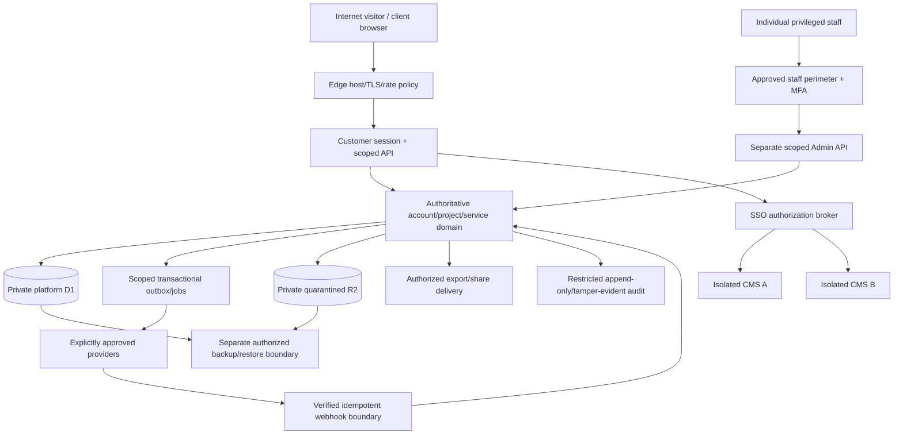

# Client Account threat model — design baseline

Status: PROPOSED / NOT TESTED. Update after discovery and before each material implementation. Risk levels are triage proposals pending actual architecture and data/legal decisions. See original security authority and151/345 fresh registers.

## Assets and actors

Assets: customer identity/recovery/MFA/session material; account/site/membership/entitlement relationships; private academic/career/budget/workspace data; project briefs/previews/approval evidence; domains/mailbox metadata; prices/quotes/invoices/payment/renewal records; support conversations/files; SSO issuer/consumer keys/nonces/site sessions; media/exports/share capabilities; audit, backup and release provenance; provider resource/cost budgets.

Actors: anonymous visitor/lead; invited/unverified/verified/suspended/closed customer; another customer; authorized collaborator only if approved; account owner; restricted support/project/billing staff; privileged operator; compromised staff/customer session; background workload; webhook/provider; malicious file/URL/content supplier; site CMS A/B; emergency operator under recorded policy.

## Data flow and boundaries

Trust boundaries: public vs authenticated customer; customer A vs B and user-private vs account-shared; customer vs staff; restricted staff vs privileged operations; browser vs Worker services; each Worker binding/environment; central platform vs each site CMS; DB vs private object storage/export origin; unauthenticated callback vs verified provider; live runtime vs backup/release pipelines. Reassess physical storage/roles after discovery; do not equate a common DB binding with safe tenant isolation.

Entry/egress points: auth/invite/verify/reset/MFA/logout; profile/security/membership; route IDs/search/history; intake/autosave/submission; preview/approval actions; quotes/payment callbacks; service/entitlement changes; support attachments; tool imports/render/QR/PDF/vCard/CSV/export/sharing; links/reference URLs; job schedulers/retries; CMS SSO issue/redeem; Admin configuration; logs/analytics/backups. Validate every route and provider-facing callback independently of UI.

## Initial abuse cases and controls to implement/test

| Threat | Initial impact | Required control direction | Test family |
|---|---|---|---|
| BOLA/cross-account data or foreign-reference substitution | Critical | Explicit scoped DAL/API/job/export checks; account/site relation integrity | SEC-01–06 |
| Audience/plan/property injection or stale entitlement bypass | High | Server-owned entitlements/allowed properties; immediate revocation rules | SEC-03,07–08 |
| Invite/reset/session/MFA takeover or enumeration | Critical | One-time scoped capabilities, rate limits, hardened sessions/recovery | SEC-09–15 |
| Staff spoofing, leaked internal notes or over-broad permissions | Critical | Separate verified identity/scope, MFA/re-auth, response allowlists, audit | SEC-05–06,16–17 |
| SSO replay/race/wrong target/old role/key confusion | Critical | Site-bound signed ticket, fixed verification policy, atomic nonce, revoke | SEC-18–22 |
| Version/approval/state/quote/price tampering | Critical | Immutable artifacts/versions, CAS, allowed transitions, server prices | SEC-23–26 |
| Forged/repeated/out-of-order payment or job processing | Critical | Verified callbacks, idempotency, reconciliation, bounded retries | SEC-25–28 |
| Stored/DOM/document/URL injection or malicious import | High | Typed validation/context encoding/sanitization, safe output formats | SEC-29–33 |
| SSRF/redirect/DNS/provider response attacks | High | Avoid fetch by default; allowlisted protected adapter contract | SEC-34–35 |
| Unsafe uploads/scanner failure/raw R2/path leaks | Critical | Private quarantine, actual scan/type/size gates, safe delivery | SEC-36–38 |
| Private cache/preview/share/export/analytics leakage | Critical | No-store/scope/revocation, clean URLs/logs, explicit sharing | SEC-39–43 |
| Email/export/regex/DB/storage/queue abuse and cost amplification | High | Limits/quotas/timeouts/circuit breakers and alerts | SEC-44–46 |
| Wrong account/timezone/autosave merge or private/public crossover | High | Versioned ownership/templates, explicit context/save/review | SEC-47–48 |
| Supply-chain/secrets/build/environment substitution | Critical | Locks/provenance/scanning/environment isolation and review | SEC-49–50 |
| Incomplete logging, fake healthy states, loss/restore mismatch | High | Redacted auditable observations, real alerts/restore/incident tests | SEC-51–54 |

All controls above are requirements, not implementation claims. Detailed risks151 and ASVS345 remain individually unassessed until evidence exists. Any newly discovered risk joins the register; mapping a broad test family does not establish full coverage.

## Failure paths and invariants

Deny missing/expired/revoked/wrong-scope identity; never fall back to another tenant/site/locale's private records. Reject stale protected mutations with recoverable conflict UX. Invalid SSO consumes no unauthorized session and simultaneous valid redemption creates at most one authorization result. Missing scan/provider/entitlement/security configuration does not allow a risky action. Unknown Health is not healthy. Failed jobs remain observable/retriable within limits and never duplicate financial/provisioning effects. Invalid legal/commercial prerequisites block the affected release/action rather than fabricating a policy.

## Privacy and residual decisions

Determine exact account/team/user ownership and read access, student/minor handling, data residency/retention/export/deletion, supported output/parser/file/provider choices, auth/recovery/SSO transport/TTL/key policy, price/tax/renewal/closure rules and RPO/RTO before the affected implementation/release. Keep personal academic/career/budget work private by default. No blanket N/A decision is made here. Assign actual mitigation/review owners and risk acceptance only after discovery; owner approval of a blueprint is not acceptance of unidentified security exceptions.
