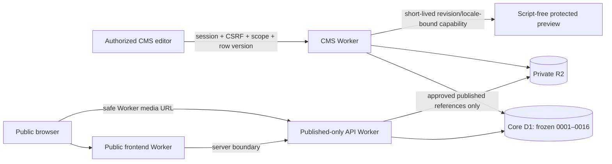

# Security delta — focused editor and section media

15 October 2026 (Asia/Beirut). Candidate; strong L2/applicable L3, independent/manual and provider gates remain open. The existing 151-title security and 345-requirement ASVS matrices remain authority. This review is an implementation delta, not a replacement security baseline or blanket N/A decision.

Assets: drafts, reviewed revisions, publication pointers, media bytes/metadata, sessions/capabilities, private analytics and inquiry data. Actors: anonymous visitors, permitted editors/publishers, unprivileged staff and concurrent/malicious clients. Trust boundaries and object/property/function authorization remain server-side; the new UI is not an authorization boundary.

Abuse/failure cases: wrong-language/stale publication, hidden dirty inputs, accidental writes when previewing, unrelated-media disclosure, unsafe media paths/alt text, template loss, overlay focus leakage, unauthorized action visibility, preview replay/expiry and publishing races. Controls: explicit save action; existing draft CAS and captured exact-revision publish/pointer checks; escaped UI values; data-only media binding to approved explicit section references with encoded Worker URLs; no external fetching/new CSP allowance; script/form-free, same-origin protected preview with no-store/no-referrer and existing revocation/expiry. Remove-photo uses the existing content writer and does not delete objects. Search overlay makes the background inert, restores focus and changes no trust boundary.

Adversarial/negative evidence includes inherited Access JWT, role/object/property authorization, CSRF/origin, SSRF/upload/path validation, immutable revisions/CAS/idempotency/replay, draft invisibility and revoked-preview/cross-origin frame refusal. New tests cover unreferenced/unsafe-alt image binding, template preservation and no hero reassignment, exact private preview image delivery and public draft invisibility. Content parity covers all 134 localized static templates. Normal-CSP browser functional checks are separate from axe-injection checks.

Approved PNG/JPEG library thumbnails use the existing media.manage-protected preview endpoint, allowlisted raster MIME and bounded base64, two requests concurrently and viewport-triggered loading. Unreviewed files remain named file cards. No raw storage URLs, persistent image cache or new provider access; stale DOM results are discarded and CMS DOM is cleared on logout. Private section-photo preview includes the selected language’s alt text through prepared queries.

No migration, server domain, dependency/lock, identity policy, SSO, provider permission or production-secret change. Current matrices retain external/manual/partial items; passing automated gates is not an ASVS or production security completion claim. No remote deployment/resource mutation/spend occurred.

The enterprise visual layer adds two unmodified self-hosted SIL-OFL fonts from pinned official repository commits. CLARITY_FONT_PROVENANCE.json records asset hashes and included licenses. No third-party font calls, script/dependency additions, broader CSP or new secrets. Public and protected-preview builds serve the same assets. Font requests/failures are included in browser validation.
