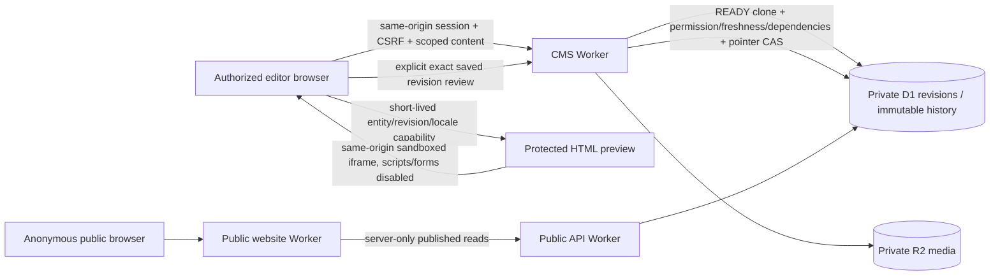

# Website Studio security delta

This delta supplements the retained 151-title owner risk matrix, 345-requirement ASVS5.0.0 mapping, threat model and release gates. It does not close them or claim strong L2/applicable L3 completion.

Assets: private drafts, media, publication truth/history, sessions, preview capabilities, staff grants and public content. Actors: editor/translator/publisher, scoped/disabled staff, malicious embedded content, cross-origin page, concurrent editor and anonymous visitor. Entry points: ordinary forms, rich-text input, disclosure controls, iframe preview, explicit publish dialog, existing specialized APIs and public Workers. Trust boundaries: staff browser/Worker, private/published revisions, preview capability/embedding origin, backend database/storage and anonymous public site.

| Risk / ASVS area | Control and required evidence |
|---|---|
| Cross-origin framing, executable preview content (V1/V3/V4) | Only protected HTML changes frame-ancestors to self and SAMEORIGIN; iframe sandbox and response CSP sandbox allow-same-origin without scripts/forms. Outer CMS still frame-ancestors none/XFO DENY. Real-browser cross-origin embedding rejection, revocation and normal same-origin preview checked. |
| Injection / unsafe formatting (V1/V2/V3) | Existing server validation remains authoritative. Inline editor uses the existing allowlisted HTML sanitizer, plain-text paste and blocked drop; no ordinary source toggle. Arbitrary script/style/event/iframe content is not enabled. |
| Confused target, stale review, race/replay (V2/V4/V8) | Capture entity/locale/revision/row/pointer before review; reject if changed. Use the server's READY clone with exact entity/locale checks; pointer CAS, fresh server identity, existing idempotency and audit remain. No retry that silently follows latest content. |
| Draft exposure, token lifetime/cache (V3/V4/V8/V14) | No public draft read. Capability scope/environment/principal/expiry/revocation unchanged. Token only in session memory/preview URL, no persistence or third-party referrer. Private no-store/noindex and same-origin assets. Published public browser remains free of CMS/direct D1/R2 access. |
| Authority/permission bypass (V8) | Simplified controls do not create authority. All original API permissions/object/property/function scope and server validation remain; publishing unavailable to non-publishers. The frozen database locale-review guard is preserved for rollback. |
| Data loss / fail-open UX (V2/V16) | Save/keep/discard before navigation, no false success, explicit local destination and separate EN/AR publication. Conflicts preserve unsaved fields and do not silently fetch a new row version for an old edit. |
| Supply chain / deployment (SSDF, V13/V15) | No dependency additions or frontend lock changes. Verified recovery dependencies reused; CMS version/lock metadata updated together. Source/manifest/checksums, fresh-extraction builds and native browser gates required. Workers/D1/R2 lineages frozen; no remote mutation. |

Preview browsers may already possess an HTML response when a capability is revoked; revocation prevents subsequent requests and refresh, not erasure of bytes already received. Script-free previews disable navigation, forms, menus/animations and inquiry submission within the editor by design; full public interactions are checked on the connected public website. The inline canvas updates after Save draft, not on every keystroke. Manual usability/accessibility, role-scope browser penetration, real Access/MFA/provider/policy/load/backup/independent release gates remain explicit limitations.
