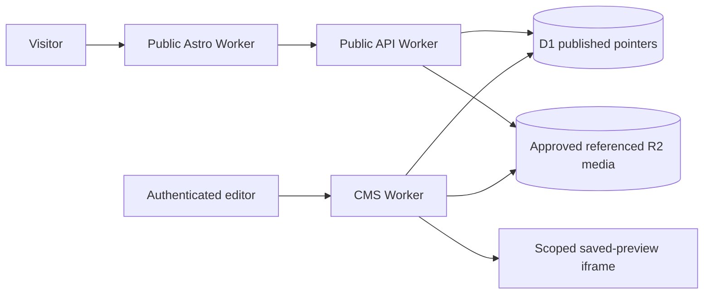

# Horizon threat model and delta

Assets: private content/media, published copy, session/CSRF, immutable revisions/publication pointer, retained review data. Actors: anonymous visitor, authorized editor/publisher, stale editor, malicious content author and other embedding origins. Boundaries: browser/public Worker; authenticated browser/CMS Worker; sandbox preview; server D1/R2 bindings; sealed source/isolated native WSL runtime.

Presentation grants no permissions. Server object/property/function checks and CAS remain authoritative. Inserted page text/IDs escaped; decorative SVG code-owned. No executable content. Preview stays same-origin entity/revision/locale/audience scoped, short lived, revocable, sandboxed without scripts/forms; cross-origin framing rejected. Canvas selection honors unsaved confirmation. Saving never publishes. Publication revalidates captured immutable revision, locale/version and pointer; concurrency fails closed.

New risks: illustrations mistaken for actual content (labelled), hidden logout (desktop explicit button/phone drawer), stale build identity (visible identity and retained no-store), narrow inspector/overflow (browser/a11y gates), preview wrapper affecting security (headers unchanged, negative tests retained). No schema/domain/dependency change or remote integration.

Inherited 151 owner risk titles and 345 ASVS requirements retain existing applicability/rationale/unresolved evidence. No partial status promoted by this UI change. ASVS5.0 strong L2/applicable L3, Top10:2025, API Top10:2023 and final SSDF1.1 remain authorities. Dedicated state/negative/embedding/CAS/input checks required beyond a11y/functional gates. Full role/manual usability/accessibility, identity/legal/providers, load/SEO, backup/deletion/incident and independent release review OPEN. No full-security/provider-verification claim.
