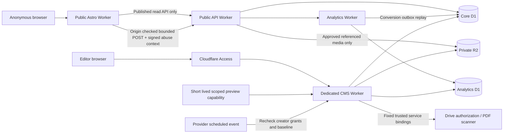

# Phase 1 integrated threat model and data flow

Scope: public website, public read/intake API, dedicated CMS, analytics, approved media and preview flows. Assets: unpublished content, media, inquiry contact data, permissions/sessions, analytics integrity, publication history, provider authorization and immutable release bytes. Actors: anonymous visitor, abusive client/bot, ordinary editor/translator, media editor, publisher, identity/config/security/analytics staff, provider and deployment operator. A compromised editor is an attacker, not a trusted source of executable content.

Trust boundaries: browser/Worker, public/CMS API, verified Access/current actor and session, ordinary editing/code-owned schema and capabilities, draft/review/published pointer, quarantine/approved referenced object, per-locale publication, server/managed provider, local/staging/production, source/build/release. Frontend has no D1/R2/KV/Images binding. Browsers never receive database credentials, R2 keys, service credentials, signed abuse-context headers or CMS API access through the public proxy.

| Abuse/failure | Implemented control and evidence path |
|---|---|
| Read private/draft or another object | Published pointer/locale state/dependency gates; private preview is entity/revision/locale/environment bound, short-lived, revocable and principal checked. Native workflow/negative tests and inherited backend/CMS suites |
| Editor writes entitlements/config via generic endpoint | Dedicated writers, permission checks, safe public projection, reserved namespaces, protected properties; native-negative and CMS contract suites |
| Forged Access identity or stale/replayed session | Strict RS256 fixed issuer/audience/certs, signature/time/type/subject checks, fresh auth, current identities/grants, server sessions/CSRF/origin. JWT fixtures test verifier behavior; actual MFA/policies are unverified |
| Publication lost update / stale approval / schedule race | Immutable revisions, review-ready action, CAS and target-bound idempotency, atomic D1 operations, exact legal hashes, cron claims/current creator authority/baseline. Parallel native attempts and cancellation/cron tests |
| XSS/injection / malicious media | Bound prepared SQL, safe text/property projection, parse5 allowlist rich prose, no arbitrary code/CSS/import URLs, safe schemes, quarantine/structural raster validation, fixed providers and fail-closed PDF scanner. CSP permits code-owned inline styles; this is a documented compatibility choice, not arbitrary editor CSS |
| Spam/resource/cost amplification | Streaming request/response bounds, fixed result/page/body sizes, short timeouts, real Worker rate bindings, signed rotating opaque abuse context; token rotation cannot choose a new server rate identity. Workers distributed rate limiting is not a guarantee against global attack; staging/load and edge policy remain required |
| PII disclosure through analytics | Minimized schema; no answers/name/email in browser events or conversion outbox; per-page opt-in and DNT/GPC. Provider edge connection metadata and legal retention remain operational decisions |
| Provider failure / SSRF / confused deputy | Server-only trusted service bindings, fixed Drive endpoints and file IDs, bound redirects/body sizes, hash/policy-matched scanner verdict, public proxy exact allowlist, unavailable → explicit failure |
| Supply-chain or release substitution | Exact locks/toolchain archives, checksums/CRC, SBOM/audit, fresh extraction. Hashes provide integrity, not an independent signature or independent acceptance |
| Local fixture escapes into production | cms-local.mjs and analytics-local.mjs are distinct entries with exact local environment/origin guards. Staging templates use strict entries and no local secrets. Local acceptance clock hooks never enter production bundles |

Residual release risks: real provider identity/MFA and resource permissions, keys/rotation, exact host/environment/spend authority, published legal text and policies, retention/deletion execution, alert/incident response, backup/restore, accessibility with assistive technology, performance/load/bot behavior and independent adversarial review. EXECUTING schedules left by a runtime interruption require audit reconciliation; auto-retry must not manufacture a different idempotency request. These are tracked release gates, not assumed PASS/N/A. See SECURITY_OWNER_TITLES.csv and ASVS_5_0_0_MATRIX.csv for explicit coverage limits.
