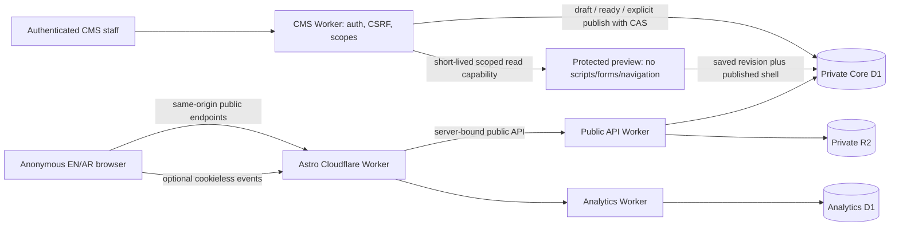

# ROOT 02 — security delta and data flow

Assets: published editorial content, unpublished revisions, publication pointers/history, CMS sessions/scoped preview capabilities, inquiry PII/idempotency, aggregate/minimized analytics, private media objects, original owner review data and immutable source artifacts.

Actors: anonymous visitors (including hostile clients/bots), authenticated scoped CMS staff, privileged publishers, local owner reviewer and future approved provider services. Audiences are not roles or tenants.

Boundaries: browser/server; public/CMS capabilities; private/published revisions; Core/Analytics; metadata/media objects; audience hint/server validation; owner original data/new isolated review; local fixture/strict provider deployment entry.

| Risk or failure | Controls and verification |
|---|---|
| Audience query becomes authorization, grants service entitlements, changes arbitrary API origin | Five-value allowlist plus actual published options; server validates stored answers; hint changes only an editable select. No gateway/storage/role/entitlement choice. Malformed hints and actual four-audience submissions tested. |
| Draft/menu save changes public design or content | Public readers use published immutable pointers. Preview issues exact revision; save never marks ready or publishes. UI saved controls, cancel, named English-menu publication, unchanged page/footer/design/Arabic and matched-theme preview tested. |
| Stale editors/reviews overwrite work | Existing row-version/CAS, immutable READY clone and stale publish review refusal remain required. Row identity, rather than duplicate href, preserves nested menu ownership. |
| CMS text/URL/article/media injects code, clobbers DOM, fetches arbitrary URLs | Escaped plain text; parse5 bounded rich-text sanitizer; safe URL policy; registered code-owned template/section registry; referenced approved media through Worker only; unknown component/unsafe URL/malformed input/negative tests. No executable CMS content. |
| Preview grants public or cross-origin access | Session/entity/revision/locale/environment-bound capability, expiry/revocation, no-store/no-referrer; sandbox same-origin, script-src none, form-action none, frame-ancestors self. Native details need no script relaxation. Appearance is a three-value read-only parameter. Cross-origin framing and revoked capability tests retained. |
| Duplicate inquiry, stale definition, abuse, PII leakage | Existing bounded server validation, origin/CSRF, server abuse context/rate limit, idempotency and version conflict recovery. PII stays Core D1, minimized analytics/outbox. No self-signup, payment, credentials in forms or activation. Dedicated adversarial suite retained. |
| New renderer revives removed/draft content or falls back across locales | Render only selected visible published sections; independently resolved locale; published-only Knowledge/search; missing shared shell fails closed; controlled backend outage503 and recovery; no fixture fallback. |
| Public browser accesses CMS/D1/R2/secrets | ASSETS-only official frontend adapter output; server public API boundary; browser request scan and public proxy denial; strict deployment local bundle scan. Local fixture auth is excluded from provider entry bundles. |
| New IA silently destroys owner edits | Separate new synthetic review data, old folders untouched, source/data hash identity. No automatic incompatible content adoption; cold/warm persistence check. No acceptance tests against owner review data. |
| Marketing claims future tools are operational | Explicit in-development account/Toolbox/Workspace descriptions; no fake sign-in or nonfunctional tool buttons; commercial launch remains gated. |

All151 owner vulnerability titles and345 ASVS5.0 verification requirements remain governed by inherited SECURITY_MASTER_BASELINE/ASVS matrices; this delta does not promote partial or external items to PASS. Strong L2/applicable privileged L3, OWASP Top10:2025/API2023 and final SSDF1.1 remain baselines. Inherited controls not exercised by this change are not newly accepted. Detailed integrated role/adversarial review, real Access/MFA/providers, legal, manual accessibility/performance/SEO, backup/restore/deletion/alerts/incident and exact staging release authority remain open. Self-tests do not establish independent acceptance or production security.
